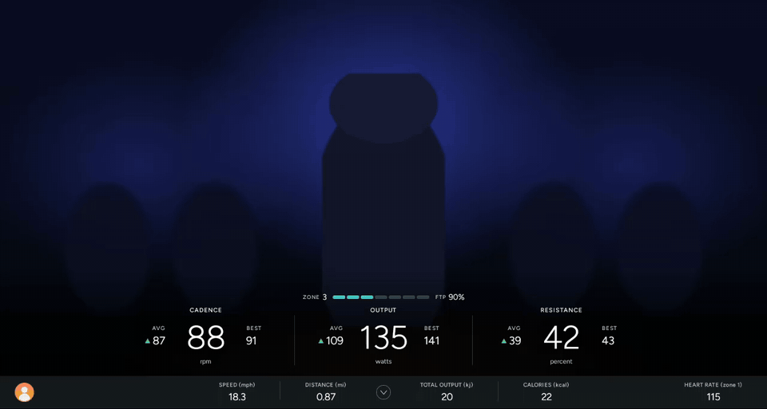
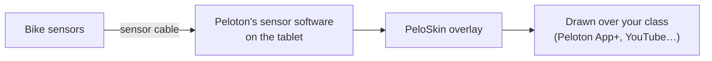

<div align="center">


**Your ride metrics and rider profiles on your Peloton bike's screen, over any app you ride to.**




</div>

Why should your metrics depend on which app is playing your class?

PeloSkin is a metrics skin for the Peloton bike's own tablet. It reads the bike's sensors
directly and draws Peloton-style numbers over whatever is on the screen. It also keeps each
rider's FTP, rides and personal records itself, so they stay with the rider whatever app or
subscription they use.

Ride to the Peloton app with App+, Apple Fitness+ on another screen, a YouTube spin class, or a
Netflix episode. Your output, zones, records and history look the same and live in one place.

## Who it's for

- You've unlocked the bike's tablet with [OpenPelo](https://github.com/doudar/OpenPelo) or another
  sideloading tool, so you can install apps on it.
- You want Peloton-style metrics without an All-Access membership, or you'd like to keep one
  record of your riding across every app you use.
- More than one person rides the bike, and each wants their own FTP, history and PRs.

Everything runs on the bike itself. **PeloSkin doesn't send your numbers anywhere else.** It
won't feed Zwift, a watch, or an app on another device. If you need your bike to act as a
Bluetooth sensor for other devices, use [Grupetto](https://github.com/doudar/grupetto). That's
what it's built for.

## Features

**On screen, over any app**

|   |   |
|---|---|
| **Full layout** | Cadence, Output and Resistance in big numbers, each with AVG (green ▲ or red ▼ trend arrow) and BEST. Below them is a solid strip with speed, distance, total output (kJ) and calories. |
| **Single-line bar** | Tap the skin to shrink it to one thin line with the numbers you pick, and tap again to bring the full layout back. Drag the bar to the top or bottom edge, and it stays there. |
| **Power zones** | A 7-zone bar with your % of FTP, using Peloton's zone boundaries. |
| **Hold to end ride** | Press and hold the skin to end your ride and see its summary straight away. There's also an **End ride** button in settings. |
| **Heart rate** | Pair any Bluetooth heart rate strap or armband, like in the Peloton app. Beats per minute show in both layouts, colored by heart rate zone. |
| **mph or km/h** | Speed and distance in miles or kilometres. |

**Your riding, kept by PeloSkin**

|   |   |
|---|---|
| **Riders** | Each rider has a name, a profile picture, and their own FTP, heart rate monitor, ride history and records. Their picture shows in the skin; tap it to switch rider, and PeloSkin connects to that rider's own heart rate monitor. |
| **Ride summary** | When a ride ends: total and average output, cadence, distance and calories, an output graph, time in each power zone, best efforts, and how it compares with your last ride of the same length. With a heart rate monitor, also average and max heart rate, a heart rate graph and time in heart rate zones. Tap any past ride to see it again. |
| **Personal records** | Best 5-second, 1-minute, 5-minute and 20-minute output, plus best total output for each class length (20, 30, 45 minutes…). A gold banner calls out a new best the moment you set it. |
| **Automatic FTP** | Your FTP is 95% of your best 20-minute average. PeloSkin tracks it on every ride and raises your FTP when you beat it. Easy rides never lower it, and a lower retest is one tap away. |
| **Lifetime totals** | Each rider's total rides, time, output, distance and calories, counting every ride ever saved. |
| **Ride history** | Each rider's last 100 rides, each with its summary and graph. Older rides drop off the list but still count toward lifetime totals and records. |
| **Backup** | Riders, pictures, settings, history, records and ride graphs are mirrored to `Documents/PeloSkin`, and come back by themselves after a reinstall. |

**Set and forget**

|   |   |
|---|---|
| **Starts with the bike** | Starts at boot and after updates, and reconnects to the bike's sensors on its own. If Android restarts it mid-ride, the ride carries on. |
| **One app** | Reads the bike itself, so there's nothing else to install or keep running. |


## Supported bikes

| Bike | Status |
|---|---|
| Peloton Bike (Gen 1) | Supported. Used daily on a PLTN-RB1VQ tablet with Android 11. |
| Peloton Bike+ | Not yet. PeloSkin detects it and says so. The code is organized so it can be added (see [AGENTS.md](AGENTS.md)). |
| Tread, Row, other devices | No |

## How it works



Peloton's own software on the tablet talks to the bike over the sensor cable and hands the
readings to apps that ask. PeloSkin subscribes to Peloton's sensor service, and falls back to
Peloton's older sensor app if the service doesn't answer.

| Shown | Where it comes from |
|---|---|
| Output, cadence | The bike, several times a second. The screen redraws 4 times a second with the average since the last redraw. |
| Resistance | The bike's latest setting, with one-off sensor glitches filtered out |
| Speed | Calculated from output with Peloton's power-to-speed curve, as measured by the [PeloMon](https://ihaque.org/posts/2020/12/25/pelomon-part-ib-computing-speed/) project |
| AVG and BEST | Averaged only while you're pedaling, so pauses don't drag them down |
| Total output, distance | Watts and speed added up over time |
| Calories | kJ ÷ 4.184 ÷ 22% body efficiency, a standard estimate |
| Power zone | Current output ÷ FTP, using Peloton's 7 zones (55 / 75 / 90 / 105 / 120 / 150%) |
| FTP | 95% of your best rolling 20-minute average |

A ride starts when you start pedaling and ends after 1 minute without pedaling, when you hold
the skin to end it, or when you tap **End ride** or **Stop** in settings. Idle time isn't counted, and rides with less than 1 minute of pedaling
aren't saved. If the bike is switched off mid-ride, the ride is saved the next time PeloSkin
starts.

## Install

You need a bike you can already sideload apps onto, and `adb` access to its tablet over USB or
wireless debugging. If you haven't done that yet, start with [OpenPelo](https://github.com/doudar/OpenPelo).

Download `app-release.apk` from [Releases](../../releases), or [build it](#build). Then:

```sh
adb install -r app-release.apk

# Let it draw over other apps, and write its backup file
adb shell appops set app.peloskin SYSTEM_ALERT_WINDOW allow
adb shell appops set app.peloskin MANAGE_EXTERNAL_STORAGE allow   # Android 11+

# Heart rate monitors: Android 11 needs location permission to find Bluetooth devices,
# including in the background while you ride, and Location turned on
adb shell pm grant app.peloskin android.permission.ACCESS_FINE_LOCATION
adb shell pm grant app.peloskin android.permission.ACCESS_BACKGROUND_LOCATION
adb shell settings put secure location_mode 3
# adb shell pm grant app.peloskin android.permission.WRITE_EXTERNAL_STORAGE   # Android 10 and older

# Keep Android from putting it to sleep mid-ride
adb shell dumpsys deviceidle whitelist +app.peloskin

adb shell am start -n app.peloskin/.MainActivity
```

Tap **Start**. From then on, PeloSkin starts with the bike and comes back by itself after updates.

Already using Grupetto just for its overlay? You don't need it for PeloSkin. Turn off its
*Start on boot* or uninstall it. If you also use Grupetto to broadcast to another device, both
can run at once, but Grupetto's own overlay will show as well.

## Using it

- **Switch layouts:** tap anywhere on the skin. The full layout becomes the single-line bar,
  and tapping the bar brings the full layout back.
- **Move the single-line bar:** drag it to the top or bottom edge.
- **Open settings:** tap the **PeloSkin** icon in your app drawer (a black wheel with a red crank arm).
  Long-press it to put it on the home screen.
- **End a ride:** press and hold the skin (either layout). A gold *Hold to end ride* bar fills
  over about 1.5 seconds; let go early to cancel. The ride is saved and its summary comes up right
  away. You can also tap **End ride** in settings. Either way the skin keeps running, and the
  next ride starts once you've stopped pedaling and start again.
- **Turn it off:** open PeloSkin and tap **Stop**. That also ends the ride in progress. Leaving
  the settings screen doesn't stop the skin.
- **Reaching your class app's buttons:** the full layout covers the bottom of the screen, where
  apps often put their controls. Tap the skin once to shrink it first.

### Heart rate

- **Pair a monitor:** on the rider's card, under *Heart rate monitor*, tap **Pair**. Put the strap
  on first (most only turn on against skin), then tap it in the list. Any monitor that uses the
  standard Bluetooth heart rate service works: Polar, Garmin, Wahoo, Coospo, Apple Watch with a
  heart rate broadcast app, and others.
- **Each rider has their own.** When you switch rider, PeloSkin drops the last monitor and looks
  for the new rider's. While it's looking, the heart shows grey with `--`.
- **Zones:** enter a max heart rate on the rider's card for the 5 heart rate zones (Peloton's:
  under 65%, 65–75%, 75–85%, 85–95% and over 95% of max). 220 minus your age is the usual estimate.
- **Also using it in the Peloton app?** Many straps allow two connections at once (the Polar H10
  does); others only one.
- Heart rate is saved second by second with each ride, ready for exporting later.

### Riders

- **Switch rider:** tap their picture under *Who's riding* in settings, or tap the picture in the
  skin to move to the next rider. A ride counts for whoever is selected when it ends.
- **Add a rider:** tap **+** under *Who's riding*, type a name, and optionally add a picture.
- **Change a name or picture, or remove a rider:** tap **Edit rider** (or the rider's picture) on
  their card.
- **Pictures:** **Choose picture** opens Android's file picker, so put a photo on the tablet
  first, for example with `adb push me.jpg /sdcard/Download/`. **Take picture** appears if the
  tablet has a camera app. Pictures are cropped to a square and shown in a circle. A rider without
  a picture gets their initials on their own color.
- **See a ride again:** tap it under *Recent rides* on the rider's card for its summary. The last
  10 rides show at first; tap **Show all** for the rest.

The settings screen puts the skin's on/off switch first, then *Who's riding* with the selected
rider's card (FTP, records and rides), then the skin's layout, start-up and backup settings.


## FTP, the short version

- **Don't know your FTP?** Take a 20-minute FTP test (the Peloton app has one) and go all out
  for the full 20 minutes. If you don't have an FTP yet, it's set when the ride ends.
- **Already know it?** Type it in under FTP.
- **Want it to update by itself?** Leave *Raise FTP when a ride beats it* on. Any ride whose best
  20 minutes beats your FTP raises it, and you'll see a short "New FTP" banner on screen.
- **Retest came in lower?** Rides never lower FTP on their own, because an easy ride would
  drag it down. Tap **Use FTP** next to that ride in *Recent rides*.
- Retesting every 6–8 weeks is typical. The settings screen reminds you after 8.

## Build

Requires JDK 17 and the Android SDK (platform 34, build-tools 34).

```sh
./gradlew testDebugUnitTest assembleRelease
# → app/build/outputs/apk/release/app-release.apk
```

Release builds are signed with the key described in `keystore.properties`. That file isn't in
git; copy `keystore.properties.example` to start one. Without it, builds use the standard
Android debug key. Use the same key for every build, because Android won't install an update
signed with a different key.

## Testing off the bike

On a device that isn't a Peloton (an emulator, say), the settings screen offers a **Demo ride**
switch that feeds PeloSkin a made-up interval ride. Demo rides never go into your history.

Unit tests in `app/src/test` cover the ride math, best efforts, time in zones, the output graph,
personal records, FTP rules, power zones, the speed curve, the resistance filter, checkpoints,
riders and the settings format (including upgrading old files), backup merging, and how the
feed falls back, reconnects and gives up. The Peloton sensor readers themselves need a real bike to test.

## Project layout

PeloSkin uses a light version of clean architecture. Dependencies only point inward
(`ui` → `data` → `domain`), and `domain` is plain Kotlin with no Android code.

```
app/src/main/java/app/peloskin/
├── domain/              Ride math, records, power zones, FTP rules, speed curve, riders and settings
├── data/
│   ├── bike/            Bike model detection, the feed, and the reader interface
│   │   └── gen1/        Gen 1 readers: Peloton's sensor service and its older sensor app
│   └── store/           Settings, ride history, ride graphs, rider pictures, backup and checkpoint files
├── ui/
│   ├── overlay/         The skin (full and single-line) and its overlay service
│   ├── summary/         The after-ride summary card
│   └── settings/        Settings screen
└── BootReceiver.kt      Start on boot and after updates
```

See [AGENTS.md](AGENTS.md) for how the Peloton sensor services work and how to add a bike model.

## FAQ

**It says "Can't read the bike".**
Check that the sensor cable is plugged into the back of the tablet, then restart the bike.
PeloSkin keeps retrying on its own.

**Can it send my numbers to Zwift, Strava, a watch, or the Peloton app?**
No, and that's on purpose: PeloSkin only shows numbers on the bike's own screen. For
broadcasting, use [Grupetto](https://github.com/doudar/grupetto).

**Does it need Grupetto?**
No. PeloSkin reads the bike through Peloton's own sensor software on the tablet.

**Which apps does it work with?**
Anything that runs on the tablet: the Peloton app (App+), YouTube, a browser, a video player or
streaming app. PeloSkin doesn't know or care what's playing; it draws on top. If your class is on
another screen, like Apple Fitness+ on an Apple TV, PeloSkin can sit over the tablet's home
screen or anything else you like.

**Why doesn't it show the class timer or cadence and resistance targets?**
Only the class app knows those. The Peloton app shows its own timer and targets panel, and it
doesn't clash with PeloSkin.

**Why does it want location permission?**
On Android 11 and older (the Gen 1 tablet), Android only lets apps look for Bluetooth devices
with location permission and Location turned on. PeloSkin uses it to find heart rate monitors and
never reads your location.

**Will it slow the bike down?**
It's under 1 MB, uses about 35 MB of memory and barely any CPU.

## Uninstall

```sh
adb uninstall app.peloskin
```

The backup in `Documents/PeloSkin` stays until you delete it.

## Credits

- [Grupetto](https://github.com/doudar/grupetto) and [PeloMon](https://github.com/ihaque/pelomon)
  figured out how the bike's sensors and Peloton's sensor software work. PeloSkin's own code
  builds on what they documented.
- [Figtree](https://github.com/erikdkennedy/figtree), the typeface, is under the SIL Open Font
  License (see `FONT-LICENSE.txt`).

## Disclaimer

PeloSkin is an independent hobby project. It isn't affiliated with, endorsed by or supported by
Peloton Interactive, Inc., Apple Inc., Google LLC or Netflix, Inc. "Peloton", "Apple Fitness+", "YouTube" and "Netflix" are trademarks of their
owners and are used here only to describe compatibility. Unlocking your bike's tablet is at your
own risk. Ride at your own risk.

## License

[MIT](LICENSE)
