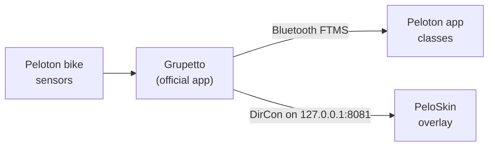

<div align="center">

# PeloSkin

**Peloton-style ride metrics for a Gen 1 Peloton bike running [Grupetto](https://github.com/doudar/grupetto).**


</div>

If you've unlocked a Gen 1 bike and run classes through the Peloton app with Grupetto feeding it
power and cadence, you've probably missed the metrics bar from the original bike software.
PeloSkin brings that look back as a lightweight overlay.

It's display only. It never talks to the bike or to Peloton's software. Grupetto does all the
technical work, and PeloSkin just draws the numbers Grupetto already publishes. When Peloton
changes something, Grupetto adapts and PeloSkin keeps working.

## Features

|   |   |
|---|---|
| **Full layout** | Cadence, Output and Resistance in big numbers, each with AVG (green ▲ or red ▼ trend arrow) and BEST. Below them is a solid strip with speed, distance, total output (kJ) and calories. |
| **Tap to switch** | Like Grupetto's overlay, tap anywhere on the skin to switch between the full layout and a single-line bar, and tap the bar to switch back. |
| **Single-line bar** | One thin line with the numbers you pick. Drag it to the top or bottom edge, and it stays there. |
| **Power zones** | A 7-zone bar with your % of FTP, using Peloton's zone boundaries. |
| **Automatic FTP** | Your FTP is 95% of your best 20-minute average. PeloSkin tracks that on every ride and raises your FTP when you beat it. Easy rides never lower it, and a lower retest is one tap away in your ride history. |
| **Ride history** | Keeps your last 100 rides with duration, average watts, kJ and best 20 minutes. |
| **Backup** | Settings, FTP and history are mirrored to `Documents/PeloSkin`, and restored automatically after a reinstall. |
| **Starts with the bike** | Starts at boot and after updates, and reconnects to Grupetto on its own. If Android restarts it mid-ride, the ride carries on. |
| **Plays well with Grupetto** | Stays on top of Grupetto's overlay, so Grupetto's minimized bar can sit hidden behind the strip. |
| **Heart rate** | Appears automatically if a heart rate strap is paired to Grupetto. |


## How it works



Grupetto publishes live ride data in the standard indoor-trainer format (Bluetooth FTMS) and
also serves it over the network as Wahoo DirCon, which is how Zwift and similar apps connect.
PeloSkin opens a DirCon connection on the tablet itself, subscribes to Indoor Bike Data
(`0x2AD2`) and Heart Rate (`0x2A37`), and works out everything else:

| Shown | Where it comes from |
|---|---|
| Output, cadence, resistance, speed | Grupetto, about once a second |
| AVG and BEST | Averaged only while you're pedaling, so pauses don't drag them down |
| Total output, distance | Watts and speed added up over time |
| Calories | kJ ÷ 4.184 ÷ 22% body efficiency, the same estimate Grupetto uses |
| Power zone | Current output ÷ FTP, using Peloton's 7 zones (55 / 75 / 90 / 105 / 120 / 150%) |
| FTP | 95% of your best rolling 20-minute average |

A ride starts when you start pedaling and ends after 5 minutes without pedaling. Those idle
minutes aren't counted, and rides with less than 5 minutes of pedaling aren't saved.

Why not fork Grupetto? A fork has to be re-signed, which means giving up official Grupetto
updates and resolving conflicts on every release. Reading Grupetto's standard data feed
avoids both.

## Requirements

- A Peloton bike tablet with Grupetto installed and running. Used daily on a Gen 1 bike
  (PLTN-RB1VQ, Android 11); it should work on Android 8 and up.
- Grupetto's **DirCon** option on (it's on by default).
- `adb` access to the tablet over USB or wireless debugging.

## Install

Download `app-release.apk` from [Releases](../../releases), or [build it](#build). Then:

```sh
adb install -r app-release.apk

# Let it draw over other apps, and write its backup file
adb shell appops set app.peloskin SYSTEM_ALERT_WINDOW allow
adb shell appops set app.peloskin MANAGE_EXTERNAL_STORAGE allow   # Android 11+
# adb shell pm grant app.peloskin android.permission.WRITE_EXTERNAL_STORAGE   # Android 10 and older

# Keep Android from putting it to sleep mid-ride
adb shell dumpsys deviceidle whitelist +app.peloskin

adb shell am start -n app.peloskin/.MainActivity
```

Tap **Start**. After that, PeloSkin starts with the bike and comes back by itself after updates.

### Tuck Grupetto's overlay away

Grupetto always shows its own overlay, and it can't be turned off without also stopping the
data PeloSkin reads. The tidy setup is to park Grupetto's minimized bar at the bottom center,
where PeloSkin's solid bottom strip covers it:

1. Tap PeloSkin once so it switches to the single-line bar and is out of the way.
2. If Grupetto's bar is minimized, tap it to expand it. Grupetto can only be dragged while
   expanded.
3. Drag Grupetto's overlay to the bottom of the screen, centered.
4. Tap its ⌄ to minimize it, then tap PeloSkin to bring the full layout back.

Grupetto remembers that position. It doesn't remember being minimized, so after a reboot,
or after you quit and reopen Grupetto, repeat steps 1 and 4.

## Using it

- **Switch layouts:** tap anywhere on the skin. The full layout becomes the single-line bar,
  and tapping the bar brings the full layout back.
- **Move the single-line bar:** drag it to the top or bottom edge.
- **Open settings:** tap the **PeloSkin** icon in your app drawer (a dark tile with teal bars).
  Long-press it to put it on the home screen.
- **Turn it off:** open PeloSkin and tap **Stop**. Leaving the settings screen doesn't stop the
  skin.
- **Reaching the Peloton app's buttons:** the full layout covers the bottom of the screen, and
  that's where the Peloton app puts *End Workout* and the progress bar. Tap the skin once to
  shrink it first.


## FTP, the short version

- **Don't know your FTP?** Take the **20 min FTP Test Ride** in the Peloton app and go all out
  for the full 20 minutes. If you don't have an FTP yet, it's set when the ride ends.
- **Already know it?** Type it in under FTP.
- **Want it to update by itself?** Leave *Raise FTP automatically* on. Any ride whose best
  20 minutes beats your FTP raises it, and you'll see a short "New FTP" banner on screen.
- **Retest came in lower?** Rides never lower FTP on their own, because an easy ride would
  drag it down. Tap **Use** next to that ride in *Recent rides*.
- Retesting every 6–8 weeks is typical. The settings screen reminds you after 8.

Tip: enter the same number in your Peloton profile, so Power Zone classes and PeloSkin agree.

## Build

Requires JDK 17 and the Android SDK (platform 34, build-tools 34).

```sh
./gradlew testDebugUnitTest assembleRelease
# → app/build/outputs/apk/release/app-release.apk
```

Release builds are signed with the key described in `keystore.properties`. That file isn't in
git; copy `keystore.properties.example` to start one. Without it, builds use the standard
Android debug key. Use the same key for every build, because Android won't install an update
signed with a different key.

## Testing off the bike

`tools/fake_grupetto.py` imitates Grupetto's feed with a made-up Power Zone ride, so you can
work on PeloSkin with an emulator instead of the bike:

```sh
python3 tools/fake_grupetto.py --hr     # on your computer; --hr adds heart rate
adb reverse tcp:8081 tcp:8081           # the emulator's 127.0.0.1:8081 → your computer
```

The feed parser, DirCon framing, ride totals and idle handling, the best-20-minute window,
ride checkpoints, power zones, FTP rules and the backup format are covered by unit tests in
`app/src/test`.

## Project layout

```
app/src/main/java/app/peloskin/
├── feed/       DirCon client and FTMS / heart rate parsers
├── ride/       Ride totals, best 20 minutes, power zones, FTP rules
├── store/      Settings, ride history, backup file
├── overlay/    Overlay service, the Compose skin (full and single-line), drag handling
├── MainActivity.kt   Settings screen
└── BootReceiver.kt   Start on boot
tools/fake_grupetto.py   Fake Grupetto feed for testing
```

## FAQ

**Does it change Grupetto or the Peloton app?**
No. Both stay exactly as installed. PeloSkin only reads Grupetto's public data feed.

**What happens when Grupetto updates?**
Nothing changes for PeloSkin. The feed is the industry-standard FTMS format that Grupetto
needs for Zwift compatibility.

**It says "Can't reach Grupetto".**
Grupetto's overlay isn't running, which happens if you tap **Quit** in Grupetto. Open
Grupetto, tap **Start overlay**, and check that Network → DirCon is on. PeloSkin reconnects
on its own within a few seconds.

**Can I hide Grupetto's overlay completely?**
Not yet. Grupetto has no hide option, and blocking its overlay stops its Bluetooth and DirCon
too. Park it behind PeloSkin's strip instead (see [Tuck Grupetto's overlay away](#tuck-grupettos-overlay-away)).

**Why doesn't it show the class timer or cadence and resistance targets?**
Only the Peloton app knows those, and it doesn't share them. The Peloton app already shows its
own timer and a targets panel, and it doesn't clash with PeloSkin.

**Will it slow the bike down?**
It's under 1 MB, uses about 35 MB of memory and barely any CPU, and updates once a second.

## Uninstall

```sh
adb uninstall app.peloskin
```

The backup in `Documents/PeloSkin` stays until you delete it.

## Credits

- [Grupetto](https://github.com/doudar/grupetto) does the hard part: reading the bike and
  sharing its data.
- [Figtree](https://github.com/erikdkennedy/figtree), the typeface, is under the SIL Open Font
  License (see `FONT-LICENSE.txt`).

## Disclaimer

PeloSkin is an independent hobby project. It isn't affiliated with, endorsed by or supported by
Peloton Interactive, Inc. "Peloton" is a trademark of its owner and is used here only to
describe compatibility. Ride at your own risk.

## License

[MIT](LICENSE)
