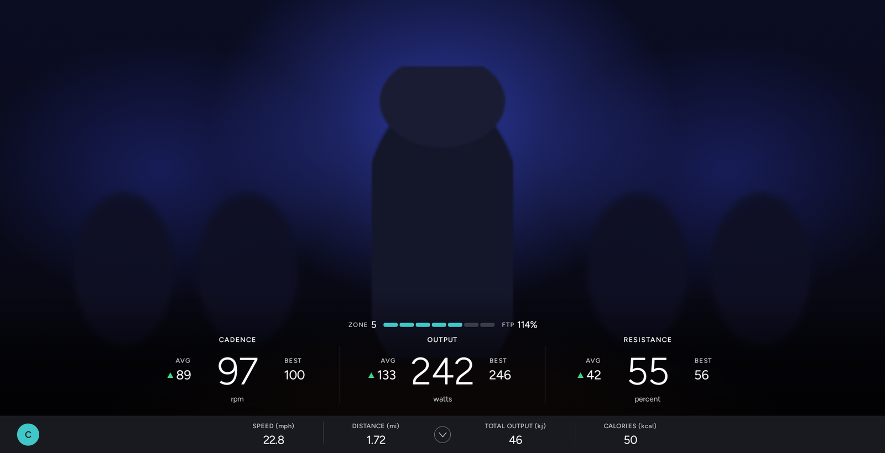
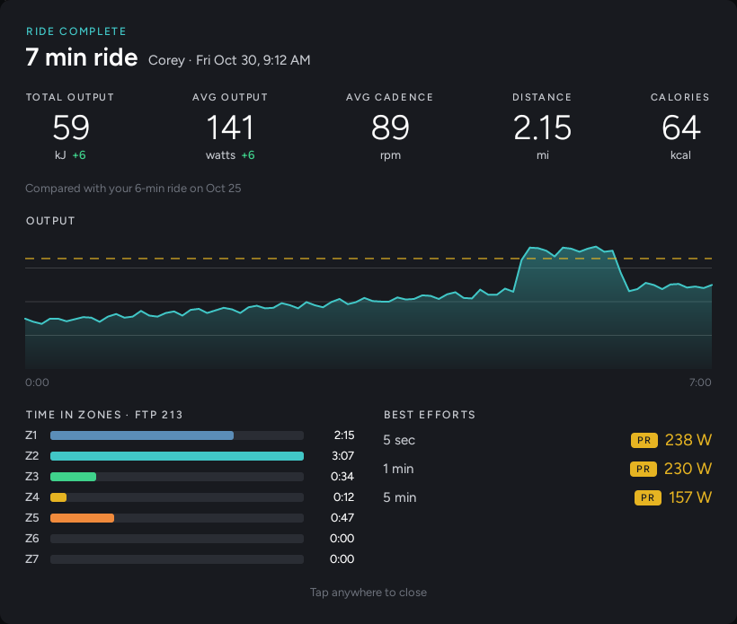
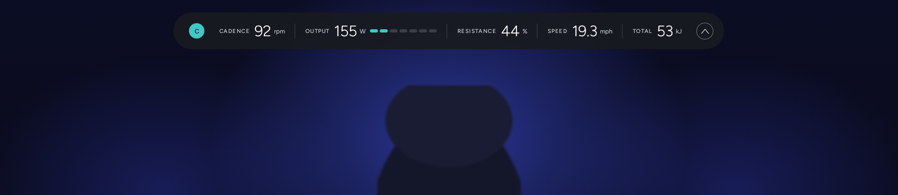
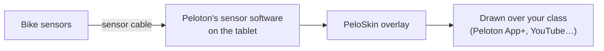
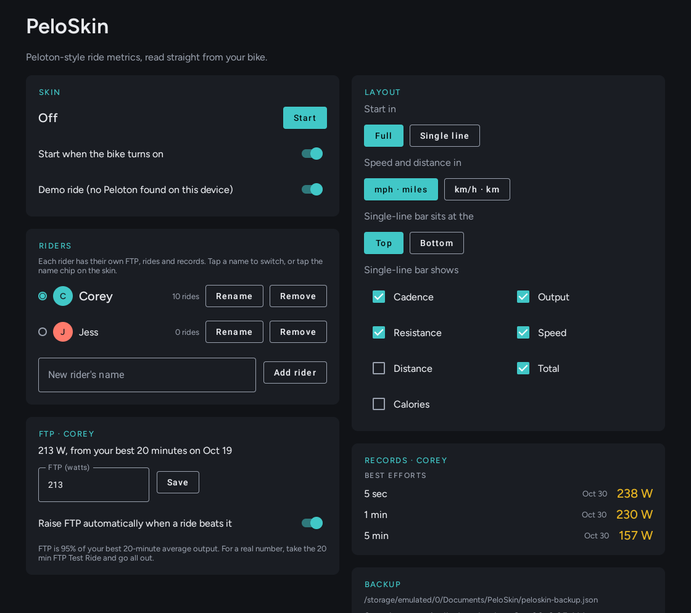

<div align="center">

# PeloSkin

**Peloton-style ride metrics on your Peloton bike's own screen, without an All-Access membership.**




</div>

PeloSkin recreates the Peloton bike's in-class metrics without an All-Access membership. It
reads the bike's sensors directly and draws a Peloton-style metrics bar over whatever you're
watching on the tablet.

## Who it's for

PeloSkin is for riding with everything on the bike itself:

- You've unlocked the bike's tablet with [OpenPelo](https://github.com/doudar/OpenPelo) or another
  sideloading tool, so you can install apps on it.
- You ride along to classes on the tablet: the **Peloton app with App+**, **YouTube**, or any other
  video or class app you can install.
- Or you follow classes on another screen, like **Apple Fitness+** on an Apple TV or iPad, and
  want your numbers on the bike in front of you.

**It doesn't send your numbers anywhere else.** It won't feed Zwift, a watch, or the Peloton
app on another device. If you need your bike to act as a Bluetooth sensor for other devices,
use [Grupetto](https://github.com/doudar/grupetto). That's what it's built for.

## Features

|   |   |
|---|---|
| **Full layout** | Cadence, Output and Resistance in big numbers, each with AVG (green ▲ or red ▼ trend arrow) and BEST. Below them is a solid strip with speed, distance, total output (kJ) and calories. |
| **Tap to switch** | Tap anywhere on the skin to switch between the full layout and a single-line bar, and tap the bar to switch back. |
| **Single-line bar** | One thin line with the numbers you pick. Drag it to the top or bottom edge, and it stays there. |
| **mph or km/h** | Pick miles or kilometres in settings. Speed and distance follow, and the choice is kept and backed up. |
| **Power zones** | A 7-zone bar with your % of FTP, using Peloton's zone boundaries. |
| **Automatic FTP** | Your FTP is 95% of your best 20-minute average. PeloSkin tracks that on every ride and raises your FTP when you beat it. Easy rides never lower it, and a lower retest is one tap away in your ride history. |
| **Riders** | Each rider has their own FTP, ride history and records. A bubble with the rider's initials, in their own color, shows who's riding in both layouts; tap it to switch. |
| **Ride summary** | When a ride ends, a summary card shows total and average output, cadence, distance and calories, an output graph, time in each power zone, your best efforts, and how it compares with your last ride of the same length. Tap any past ride to see it again. |
| **Personal records** | Best 5-second, 1-minute, 5-minute and 20-minute output, plus best total output for each class length (20, 30, 45 minutes…). A gold banner calls out a new best effort the moment you set it; ride-length records show when the ride ends. |
| **Ride history** | Keeps each rider's last 100 rides. |
| **Backup** | Riders, settings, history, records and ride graphs are mirrored to `Documents/PeloSkin`. After a reinstall, riders, history and records come back automatically, and ride graphs are read from the backup folder. |
| **Starts with the bike** | Starts at boot and after updates, and reconnects to the bike's sensors on its own. If Android restarts it mid-ride, the ride carries on. |
| **One app** | Reads the bike itself, so there's nothing else to install or keep running. |





## Supported bikes

| Bike | Status |
|---|---|
| Peloton Bike (Gen 1) | Supported. Used daily on a PLTN-RB1VQ tablet with Android 11. |
| Peloton Bike+ | Not yet. PeloSkin detects it and says so. The code is organized so it can be added (see [AGENTS.md](AGENTS.md)). |
| Tread, Row, other devices | No |

## How it works



Peloton's own software on the tablet talks to the bike over the sensor cable and hands the
readings to apps that ask. PeloSkin subscribes to Peloton's sensor service, and falls back to
Peloton's older sensor app if the service doesn't answer.

| Shown | Where it comes from |
|---|---|
| Output, cadence | The bike, several times a second. The screen redraws 4 times a second with the average since the last redraw. |
| Resistance | The bike's latest setting, with one-off sensor glitches filtered out |
| Speed | Calculated from output with Peloton's power-to-speed curve, as measured by the [PeloMon](https://ihaque.org/posts/2020/12/25/pelomon-part-ib-computing-speed/) project |
| AVG and BEST | Averaged only while you're pedaling, so pauses don't drag them down |
| Total output, distance | Watts and speed added up over time |
| Calories | kJ ÷ 4.184 ÷ 22% body efficiency, a standard estimate |
| Power zone | Current output ÷ FTP, using Peloton's 7 zones (55 / 75 / 90 / 105 / 120 / 150%) |
| FTP | 95% of your best rolling 20-minute average |

A ride starts when you start pedaling and ends after 5 minutes without pedaling, or when you
tap **Stop**. Idle minutes aren't counted, and rides with less than 5 minutes of pedaling
aren't saved. If the bike is switched off mid-ride, the ride is saved the next time PeloSkin
starts.

## Install

You need a bike you can already sideload apps onto, and `adb` access to its tablet over USB or
wireless debugging. If you haven't done that yet, start with [OpenPelo](https://github.com/doudar/OpenPelo).

Download `app-release.apk` from [Releases](../../releases), or [build it](#build). Then:

```sh
adb install -r app-release.apk

# Let it draw over other apps, and write its backup file
adb shell appops set app.peloskin SYSTEM_ALERT_WINDOW allow
adb shell appops set app.peloskin MANAGE_EXTERNAL_STORAGE allow   # Android 11+
# adb shell pm grant app.peloskin android.permission.WRITE_EXTERNAL_STORAGE   # Android 10 and older

# Keep Android from putting it to sleep mid-ride
adb shell dumpsys deviceidle whitelist +app.peloskin

adb shell am start -n app.peloskin/.MainActivity
```

Tap **Start**. From then on, PeloSkin starts with the bike and comes back by itself after updates.

Already using Grupetto just for its overlay? You don't need it for PeloSkin. Turn off its
*Start on boot* or uninstall it. If you also use Grupetto to broadcast to another device, both
can run at once, but Grupetto's own overlay will show as well.

## Using it

- **Switch layouts:** tap anywhere on the skin. The full layout becomes the single-line bar,
  and tapping the bar brings the full layout back.
- **Move the single-line bar:** drag it to the top or bottom edge.
- **Open settings:** tap the **PeloSkin** icon in your app drawer (a dark tile with teal bars).
  Long-press it to put it on the home screen.
- **Turn it off:** open PeloSkin and tap **Stop**. Leaving the settings screen doesn't stop the
  skin.
- **Add a rider:** in settings under *Riders*, type a name and tap **Add rider**. With more than
  one rider, a bubble with the rider's initials appears at the left of the full layout's bottom
  strip and at the start of the single-line bar; tap it to switch. A ride
  counts for whoever is selected when it ends.
- **See a ride again:** tap it under *Recent rides* for its summary card. The last 10 rides show
  at first; tap **Show all** for the rest.
- **Reaching your class app's buttons:** the full layout covers the bottom of the screen, where
  the Peloton app puts *End Workout* and the progress bar. Tap the skin once to shrink it first.



## FTP, the short version

- **Don't know your FTP?** Take a 20-minute FTP test (the Peloton app has one) and go all out
  for the full 20 minutes. If you don't have an FTP yet, it's set when the ride ends.
- **Already know it?** Type it in under FTP.
- **Want it to update by itself?** Leave *Raise FTP automatically* on. Any ride whose best
  20 minutes beats your FTP raises it, and you'll see a short "New FTP" banner on screen.
- **Retest came in lower?** Rides never lower FTP on their own, because an easy ride would
  drag it down. Tap **Use** next to that ride in *Recent rides*.
- Retesting every 6–8 weeks is typical. The settings screen reminds you after 8.

## Build

Requires JDK 17 and the Android SDK (platform 34, build-tools 34).

```sh
./gradlew testDebugUnitTest assembleRelease
# → app/build/outputs/apk/release/app-release.apk
```

Release builds are signed with the key described in `keystore.properties`. That file isn't in
git; copy `keystore.properties.example` to start one. Without it, builds use the standard
Android debug key. Use the same key for every build, because Android won't install an update
signed with a different key.

## Testing off the bike

On a device that isn't a Peloton (an emulator, say), the settings screen offers a **Demo ride**
switch that feeds PeloSkin a made-up interval ride. Demo rides never go into your history.

Unit tests in `app/src/test` cover the ride math, best efforts, time in zones, the output graph,
personal records, FTP rules, power zones, the speed curve, the resistance filter, checkpoints,
riders and the settings format (including upgrading old files), backup merging, and how the
feed falls back, reconnects and gives up. The Peloton sensor readers themselves need a real bike to test.

## Project layout

PeloSkin uses a light version of clean architecture. Dependencies only point inward
(`ui` → `data` → `domain`), and `domain` is plain Kotlin with no Android code.

```
app/src/main/java/app/peloskin/
├── domain/              Ride math, records, power zones, FTP rules, speed curve, riders and settings
├── data/
│   ├── bike/            Bike model detection, the feed, and the reader interface
│   │   └── gen1/        Gen 1 readers: Peloton's sensor service and its older sensor app
│   └── store/           Settings, ride history, ride graphs, backup and checkpoint files
├── ui/
│   ├── overlay/         The skin (full and single-line) and its overlay service
│   ├── summary/         The after-ride summary card
│   └── settings/        Settings screen
└── BootReceiver.kt      Start on boot and after updates
```

See [AGENTS.md](AGENTS.md) for how the Peloton sensor services work and how to add a bike model.

## FAQ

**It says "Can't read the bike".**
Check that the sensor cable is plugged into the back of the tablet, then restart the bike.
PeloSkin keeps retrying on its own.

**Can it send my numbers to Zwift, Strava, a watch, or the Peloton app?**
No, and that's on purpose: PeloSkin only shows numbers on the bike's own screen. For
broadcasting, use [Grupetto](https://github.com/doudar/grupetto).

**Does it need Grupetto?**
No. PeloSkin reads the bike through Peloton's own sensor software on the tablet.

**Why doesn't it show the class timer or cadence and resistance targets?**
Only the class app knows those. The Peloton app shows its own timer and targets panel, and it
doesn't clash with PeloSkin.

**What about heart rate?**
PeloSkin doesn't show it. Pair your heart rate strap with your class app (the Peloton app has a
Bluetooth heart rate option) and it'll show there.

**Will it slow the bike down?**
It's under 1 MB, uses about 35 MB of memory and barely any CPU.

## Uninstall

```sh
adb uninstall app.peloskin
```

The backup in `Documents/PeloSkin` stays until you delete it.

## Credits

- [Grupetto](https://github.com/doudar/grupetto) and [PeloMon](https://github.com/ihaque/pelomon)
  figured out how the bike's sensors and Peloton's sensor software work. PeloSkin's own code
  builds on what they documented.
- [Figtree](https://github.com/erikdkennedy/figtree), the typeface, is under the SIL Open Font
  License (see `FONT-LICENSE.txt`).

## Disclaimer

PeloSkin is an independent hobby project. It isn't affiliated with, endorsed by or supported by
Peloton Interactive, Inc. or Apple Inc. "Peloton" and "Apple Fitness+" are trademarks of their
owners and are used here only to describe compatibility. Unlocking your bike's tablet is at your
own risk. Ride at your own risk.

## License

[MIT](LICENSE)
